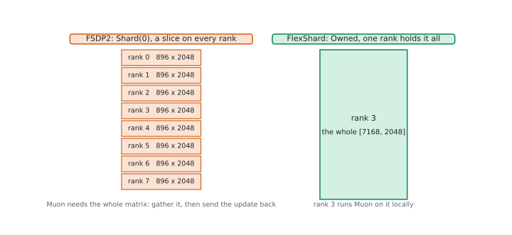
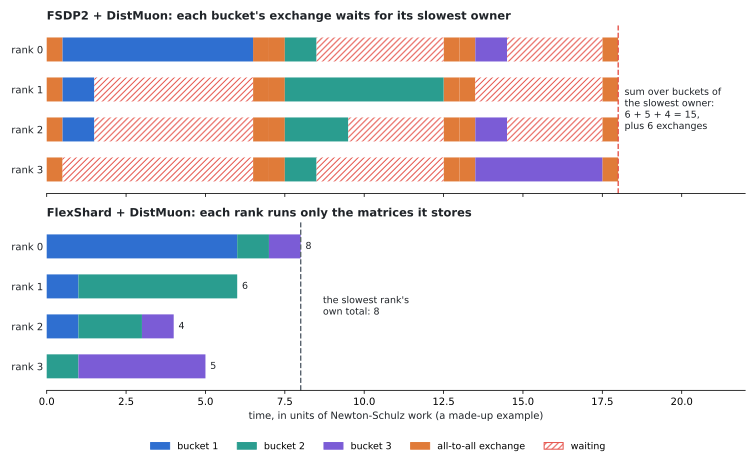
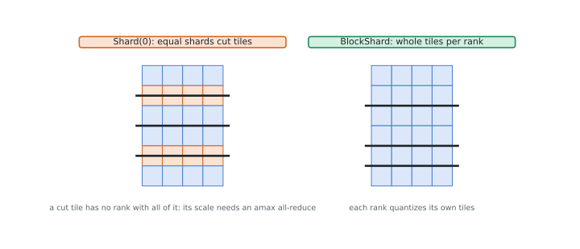
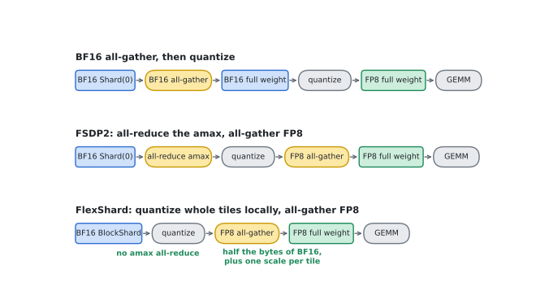

# FlexShard

FlexShard is an experimental data-parallel sharding library for PyTorch. Like
FSDP2, it shards parameters, gradients and optimizer states over GPUs, gathers
each layer's parameters for forward and backward, and reduce-scatters their
gradients. Unlike FSDP2, it lets each group of parameters choose how it is
stored: explicit buckets name the parameters that communicate together, the
device mesh they use, and their placement, including placements that keep
matrices and quantization tiles whole on one GPU. Optimizers work on ordinary
local tensors.

- **Buckets like FSDP2's.** With `Shard` placements, a bucket can reproduce
  the collectives of an FSDP2 `fully_shard` group byte for byte, so training is
  bitwise identical to FSDP2.
- **Storage the optimizer can use.** Owner storage (`BucketedOwned`) and
  `BlockShard` keep each Muon matrix whole on the GPU that orthogonalizes it, so
  the optimizer step needs no communication.
- **Storage quantization can use (experimental).** `Fp8BucketedBlockShard`
  keeps whole 128-row blocks on each GPU, which quantizes its own weights and
  all-gathers FP8. The [`fp8-stack`](https://github.com/meta-pytorch/flex_shard/tree/fp8-stack)
  branch has the newest FP8 work.
- **Placements of your own**, on the same runtime for bucketing, prefetching
  and overlap.

[Train DeepSeek V3 16B](#train-deepseek-v3-16b) shows the first two at work:
expert parallelism with buckets that train bitwise like torchtitan's FSDP2, and
Muon without communication.

## Why FlexShard

### Muon needs whole matrices

<p align="center"></p>

Muon orthogonalizes each matrix's momentum with a Newton-Schulz iteration, so
each matrix has to be whole on the GPU that runs it. FSDP2's `Shard(0)` leaves a
slice of every matrix on every GPU, and Megatron's distributed optimizer cuts
matrices where its buffer's rank ranges meet, so each step gathers matrices to
the GPUs that run them and sends the updates back. FlexShard's
owner storage (`BucketedOwned`) keeps a whole matrix on one GPU, and `BlockShard`
keeps whole blocks of its rows, such as attention heads, so the optimizer runs on
local storage.

<p align="center"></p>

The exchange also makes GPUs wait for each other. DistMuon sends each bucket of
matrices to the GPUs that orthogonalize them, so every bucket waits for its
slowest GPU, and the step takes the sum of those slowest times. When each matrix
is stored where it is orthogonalized, each GPU runs its own matrices back to
back, and the step takes the slowest GPU's own total. On DeepSeek V3 671B with
256 H100s (pipeline parallelism 4, data parallelism 64), the slowest GPU's
optimizer step, timed on the GPU, took 301 ms with owner storage against 527 ms
with FSDP2's, 43% shorter. The training step, 69 seconds, varies more than that
from job to job.

### Blockwise quantization needs whole tiles

FP8 support is experimental; the
[`fp8-stack`](https://github.com/meta-pytorch/flex_shard/tree/fp8-stack) branch
has the newest work.

<p align="center"></p>

FP8 training with blockwise scaling gives each 128 x 128 tile of a weight its
own scale. FSDP2's equal shards can cut a tile where two shards meet, and no GPU
holds all of a cut tile, so the weights are either all-gathered in BF16 and
quantized after, or quantized after an all-reduce of each tile's largest value
(amax).
`Fp8BucketedBlockShard` gives each GPU whole 128-row blocks of a bucket instead:

<p align="center"></p>

Each GPU quantizes its own tiles without an all-reduce, and the all-gather moves
FP8 data and one scale per tile, about half the bytes of BF16. The gathered
weight is bit for bit the one all-gathering BF16 and quantizing after would give
([`fp8_bucketed_block_shard.py`](src/flex_shard/custom_placements/fp8_bucketed_block_shard.py)).

### Placements are pluggable

A placement decides which part of each parameter a GPU stores, and how a bucket
gathers its parameters and reduces their gradients: `Shard` uses all-gather and
reduce-scatter, for example. One runtime serves every placement, with
bucketing, prefetching, overlap of communication and compute, resharding,
gradient accumulation and distributed checkpoints, so a new storage scheme is a
`Placement` subclass
([`placement_contract.py`](src/flex_shard/flex_shard/placement_contract.py))
rather than a new FSDP. Built in:

| Placement | Each GPU stores | As in |
| --- | --- | --- |
| `Shard(i)` | an equal slice of each parameter, along dim `i` | FSDP2 |
| `BucketedBlockShard` | a range of one flat buffer per bucket | FSDP1, Megatron's distributed optimizer, veScale-FSDP |
| `BucketedOwned` | whole parameters, or whole slabs along dim 0 | new |
| `BlockShard` | whole blocks of a parameter, along one dim | new |
| `Fp8BucketedBlockShard` | whole 128-row blocks, gathered as FP8 | new |

## Requirements and installation

| Component | Requirement |
| --- | --- |
| Python | 3.10 or later |
| PyTorch | 2.16 or later; until 2.16 is released, a nightly from 2.16.0.dev20261009 on |
| Platform | Linux with NVIDIA GPUs |
| CUDA and NCCL | A CUDA-enabled PyTorch build with NCCL and a compatible NVIDIA driver |
| Triton | `~=3.8.0` on Linux |

Install a CUDA-enabled PyTorch build satisfying this requirement, then install
FlexShard from the repository:

```bash
git clone https://github.com/meta-pytorch/flex_shard.git
cd flex_shard
python -m pip install -e .
```

The distribution is named `flex-shard`; import it as `flex_shard`.

## Buckets, storage sharding and compute sharding

Three choices describe how FlexShard shards a model:

- **Bucket**: which parameters and gradients go together in one all-gather and
  one reduce-scatter. `BucketSpec(patterns, ...)` names them by fully qualified
  name.
- **Storage sharding**: how a bucket stores its parameters between uses: its
  `placement_fn` and its device `mesh`.
- **Compute sharding**: how parameters are laid out where they are used. Forward
  and backward see them replicated over the bucket's mesh; tensor or expert
  parallelism shard them further, which FlexShard takes as an
  [outer sharding](#outer-shardings). The optimizer may compute in yet another
  layout, which [`flex_shard.dist_muon`](src/flex_shard/dist_muon)'s DistMuon
  describes per parameter.

Coming from FSDP2:

| FSDP2 | FlexShard |
| --- | --- |
| Apply `fully_shard` to child modules, then the root | Call `flex_shard` once with explicit buckets |
| `shard_placement_fn` returning `Shard(i)` | A `placement_fn` returning `Shard(i)`; one bucket may mix dims |
| `fully_shard(layer.experts, mesh=efsdp_mesh)` | Expert `BucketSpec(..., mesh=efsdp_mesh)` |
| `set_modules_to_forward_prefetch` / `set_modules_to_backward_prefetch` | `set_buckets_to_forward_prefetch` / `set_buckets_to_backward_prefetch` on entries of `sharded_bucket_storages` |
| `unshard()`, `reshard()` and `set_reshard_after_forward` on one `fully_shard` group | The same methods on its bucket's storage, from `sharded_bucket_storages` or `model.bucket_storage_of(param)` |
| The optimizer manages DTensor parameters | The optimizer manages ordinary local shards; construct it after sharding |
| DCP checkpoints DTensor state dicts | DCP checkpoints local shards that declare their layouts; see [Distributed checkpoints](#distributed-checkpoints) |

## Train DeepSeek V3 16B

[`examples/deepseek_v3`](examples/deepseek_v3) trains torchtitan's DeepSeek V3
16B in plain PyTorch, without torchtitan, on one host with 8 GPUs. The model has
27 blocks, one dense and 26 with 64 routed experts (top 6) and 2 shared experts,
multi-head latent attention and 15.7 billion parameters, 2.7 billion of them
active per token. It uses deepseek-moe-16b-base's tokenizer, as torchtitan does;
that model's weights don't fit this architecture.

```bash
pip install -r examples/deepseek_v3/requirements.txt  # datasets and tokenizers, for C4
torchrun --standalone --nproc-per-node 8 examples/deepseek_v3/train.py \
    --data c4 --local-batch-size 4 --steps 1000 --optimizer muon
```

Leave out `--optimizer muon` for AdamW, and `--data c4` for random tokens and no
extra packages. `--ep` sets the expert-parallel degree, `--ep 1` turning expert
parallelism off; `--checkpoint-dir` saves DCP checkpoints and resumes from the
latest; `--deterministic` makes runs bitwise reproducible; `--help` lists the
rest.

### Expert parallelism, and buckets like FSDP2's

The routed experts use expert parallelism (EP) over `--ep` GPUs, half of them by
default: GPUs 0 to 3 split each block's 64 experts, 16 each, and so do GPUs 4 to
7. [`expert_parallel.py`](examples/deepseek_v3/expert_parallel.py) ports
torchtitan's all-to-all token dispatch: each routed copy of a token goes to the
GPU holding its expert and its output comes back, one all-to-all each way.
FlexShard then shards each GPU's 16 experts over the GPUs that hold the same
ones (expert FSDP, EFSDP): GPUs 0 and 4, 1 and 5, and so on, 8 experts each.
Everything else is sharded over all 8 GPUs (FSDP).

The model is built on the meta device, sharded, then initialized with
`init_from_full`, which has every rank draw each full parameter and keep its
part, so the weights don't depend on the number of GPUs. `apply_expert_parallel`
declares where each GPU's experts sit in the full weights (`set_global_layout`),
so initialization and checkpoints see full weights there too. Each bucket is one
group of torchtitan's FSDP2 setup:

```python
mesh = init_device_mesh("cuda", (8,), mesh_dim_names=("dp",))
expert_mesh = init_device_mesh("cuda", (2, 4), mesh_dim_names=("efsdp", "ep"))
apply_expert_parallel(model, expert_mesh["ep"])  # keep this GPU's experts


def bucket(patterns, reshard_after_forward=True, mesh=mesh):
    return BucketSpec(
        patterns,
        placement_fn=placement_fn,  # Shard(1) for [2, F, D] gate/up weights, else Shard(0)
        mesh=mesh,
        mp_policy=MixedPrecisionPolicy(param_dtype=torch.bfloat16, reduce_dtype=torch.float32),
        gradient_divide_factor=1.0,  # sum gradients: the loss is divided by all GPUs' tokens
        reshard_after_forward=reshard_after_forward,
    )


buckets = [bucket(["tok_embeddings"])]
for i, block in enumerate(model.layers):
    names = [f"layers.{i}.{name}" for name, _ in block.named_parameters()]
    experts = [name for name in names if ".routed_experts." in name]
    buckets.append(bucket([name for name in names if name not in experts]))
    if experts:
        buckets.append(bucket(experts, mesh=expert_mesh["efsdp"]))
buckets.append(bucket(["norm", "lm_head"], reshard_after_forward=False))
flex_shard(model, buckets=buckets)
```

With EP, each expert's gradient already sums the tokens of its EP group, so the
expert buckets can't take the default, which averages over each bucket's own
mesh; summing everywhere, with the loss divided by all GPUs' tokens, is what
torchtitan does. As torchtitan does under EP, the example also prefetches the
next block's buckets explicitly, and clips with the experts' gradient norm taken
over their two mesh dims in turn, as DTensor reduces it. From torchtitan's
initial weights and on the same batches, losses and gradient norms are bitwise
equal to torchtitan's FSDP2 training with the same EP at every step of a 10-step
deterministic run, with SDPA and with FlexAttention, and so they are with
`--ep 1`.

### Muon without communication

With `--optimizer muon`, FlexShard stores each matrix where Muon computes it:

- A mixture-of-experts block's routed experts already have a bucket of their
  own, whose `Shard(0)` keeps experts whole: each GPU stores 8.
- After initialization or loading, `relayout_bucket` moves the rest of each block
  to whole-parameter owners (`BucketedOwned`), balanced over the GPUs across
  blocks. Forward and backward gather each parameter from its owner and reduce
  its gradient back to it.

```python
placement_fn = make_bucketed_owned_full_param_placement_fn(carry_loads=True)
for storage in owner_buckets:  # each block's bucket other than the routed experts
    relayout_bucket(model, storage, placement_fn)
```

`build_local_dist_muon` then runs `flex_shard.dist_muon.DistMuon` on each GPU's
own storage, on a one-GPU mesh where storage already is the compute layout, so
the step moves nothing ([`muon.py`](examples/deepseek_v3/muon.py)). Profiles of
the optimizer step show no NCCL kernel on any GPU, and on a three-block cut of
the model its updates equal DistMuon's on the full parameters and gradients,
bit for bit, with or without EP. The compute layouts are Kimi K2's matrices
(attention projections per head and role, each expert, the rest whole), with its
update scaling, `0.2 * sqrt(max(rows, columns))`, so Muon takes AdamW's learning
rate; AdamW trains the embedding, norms and output projection. Checkpoints hold
the owner-stored weights and DistMuon's momentum.

## Gradients, resharding and accumulation

- `gradient_reduce_op` defaults to `dist.ReduceOp.AVG`, the sum over the bucket's
  mesh divided by `gradient_divide_factor`, the mesh size by default, as FSDP2's
  `set_gradient_divide_factor`. With expert parallelism, set it to the dense
  data-parallel size on expert buckets.
- Each managed parameter has a persistent unsharded `nn.Parameter`, which the
  owning module holds while its bucket is gathered. `reshard_after_forward=True`
  frees it after forward and re-gathers it before backward, composing with
  activation checkpointing. With `False`, call `model.reshard()` when the
  backward won't run.
- Gradient accumulation: `model.set_requires_gradient_sync(is_last)` before each
  microbatch, as with FSDP2. Backwards without sync keep full gradients on the
  unsharded parameters; `model.set_reshard_after_backward(False)` also keeps the
  parameters gathered between microbatches. Both setters also exist per bucket.
- `model.finalize_backward()` reduce-scatters accumulated gradients outside a
  backward (`async_op=True` returns a handle).
  `model.set_manual_backward_finalization(True)` makes backwards finish nothing,
  leaving it to one `finalize_backward()` per step.
- `BucketSpec(defer_post_backward=True)` waits for
  `model.finish_deferred_backward(param)`, for kernels that compute weight
  gradients late, such as TransformerEngine's `delay_wgrad_compute`.
- `model.unshard()` gathers every bucket for schedules that bypass forward hooks;
  `async_op=True` returns a handle, as in FSDP2.
- A bucket naming several modules handles forwards that skip some of them and
  calls of one of them alone, as torchtitan's chunked loss does, and
  reduce-scatters like FSDP2 bit for bit.
- FlexShard does not recover from errors: after a backward that raises, the next
  forward or `model.reshard()` raises too.

## Outer shardings

A parameter that is already a local shard of another sharding, such as tensor or
expert parallelism, is passed in as that plain local tensor:

- `set_global_layout(param, layout)`, before `flex_shard()`, declares where it
  sits in the full parameter; checkpoints compose it with FlexShard's split.
- `set_partial_grad_group(param, group)` declares a group whose ranks each
  compute only part of its gradient, such as a norm weight under sequence
  parallelism; FlexShard sums it over that group before the reduce-scatter.

## Distributed checkpoints

A FlexShard `state_dict()` holds each rank's local shards. To checkpoint them
with PyTorch distributed checkpointing (DCP), declare where each shard sits in
the full tensor:

```python
import torch.distributed.checkpoint as dcp
from flex_shard import register_optimizer_checkpoint_hook, set_state_dict_global_layouts

register_optimizer_checkpoint_hook(optimizer, model)  # once, after flex_shard()


def checkpoint_state_dict():
    model_state_dict = model.state_dict()
    set_state_dict_global_layouts(model, model_state_dict)
    return {"model": model_state_dict, "optim": optimizer.state_dict()}


dcp.save(checkpoint_state_dict(), checkpoint_id=path)

state_dict = checkpoint_state_dict()
dcp.load(state_dict, checkpoint_id=path)
model.load_state_dict(state_dict["model"])
optimizer.load_state_dict(state_dict["optim"])
```

DCP loads shards by their global offsets, so a checkpoint loads at another
number of ranks, and FSDP2 checkpoints of the same model load into FlexShard
and back. As for any `dcp.load` into `optimizer.state_dict()`, the optimizer
needs its states first, for example from a step with zero gradients. The
optimizer hook supports Adam and AdamW. The declarations are attributes of the
state-dict tensors: a copy, such as a `.to(dtype)` cast, needs
`set_state_dict_global_layouts` again. DCP's process-based `async_save` drops
them and saves each shard as if it were the full tensor, without raising; the
default thread-based one keeps them.

## FlexShard in training frameworks

- [weifengpy/torchtitan-flexshard](https://github.com/weifengpy/torchtitan-flexshard):
  torchtitan with `parallelism.fsdp_backend="flex_shard"`, which trains bitwise
  like its FSDP2 backend, and DistMuon from `flex_shard.dist_muon`.
- [weifengpy/Megatron-flexshard](https://github.com/weifengpy/Megatron-flexshard):
  Megatron-LM with FlexShard as a data-parallel backend (`--use-flex-shard`),
  next to DDP and the distributed optimizer.

## Limitations

- The API is experimental and uses private PyTorch APIs; the declared version
  range matters.
- Each bucket requires a one-dimensional CUDA mesh; different buckets may use
  different submeshes. CPU offload is not supported.
- Every parameter must match exactly one bucket.
- Every rank must run the same graph. A bucket whose outputs only some ranks'
  losses use can reduce at a different point of backward on each rank, so the
  collectives mismatch.
- The DeepSeek V3 example runs on one host, with expert parallelism but no
  tensor, pipeline or context parallelism; `--ep` must divide the GPUs and the
  64 experts.
- Numerical comparisons here concern the stated configurations; they are not
  general FSDP2 benchmarks.

## Development and testing

```bash
python -m pip install -e '.[test]'
python -m pytest
```

Use at least four GPUs for the full suite. Tests skip when required hardware
is unavailable; CPU-only checks do not validate distributed training.
[`docs/images/make_figures.py`](docs/images/make_figures.py) redraws this
README's figures (it needs matplotlib).

See [CONTRIBUTING.md](CONTRIBUTING.md) for the contribution workflow and
[CODE_OF_CONDUCT.md](CODE_OF_CONDUCT.md) for community expectations.

## License

FlexShard is BSD-3-Clause licensed; see [LICENSE](LICENSE).
